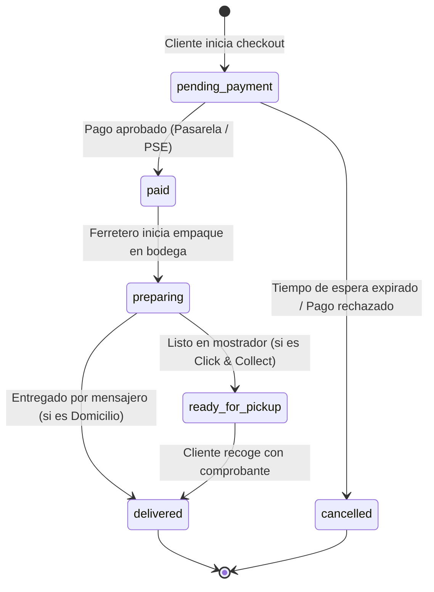

# Reglas de Negocio, Control de Inventario y Operación

Este documento compila las directrices y reglas operativas que rigen el comportamiento funcional de la plataforma **FerroMax**, garantizando la integridad del inventario, la consistencia en el cobro y la fluidez del servicio al cliente.

---

## 1. Reglas de Control de Inventario

### 1.1. Umbrales de Stock y Semáforo Visual
Para ofrecer claridad inmediata tanto al comprador como al ferretero, cada producto se clasifica automáticamente según sus existencias:

| Estado de Inventario | Rango de Existencias | Badge Visual | Comportamiento en la Plataforma |
| :--- | :--- | :--- | :--- |
| **Stock Normal** | `stock_quantity > min_stock_alert` (por defecto > 5) | `Verde ("En Stock")` | Compra y adición al carrito habilitadas con normalidad. |
| **Stock Crítico / Escaso** | `1 <= stock_quantity <= min_stock_alert` (1 a 5 uds) | `Ámbar ("¡Últimas X unidades!")` | Notificación visible de urgencia. Límite máximo en el carrito igual a las unidades disponibles. |
| **Agotado** | `stock_quantity = 0` | `Gris / Rojo ("Agotado en tienda")` | Botón de compra deshabilitado. Se reemplaza por *"Avisarme o Consultar por WhatsApp"*. |

### 1.2. Prevención de Sobreventa (Overselling & Concurrency)
- No se permite que el carrito de compras contenga una cantidad superior a la existencia física reportada.
- Al momento de pulsar el botón *"Pagar Pedido"*, el sistema ejecuta una verificación atómica en el servidor (`SELECT stock_quantity FROM products WHERE id = $1 FOR UPDATE`).
- Si en el lapso entre que el usuario llenó el carrito y pagó otro cliente agotó las existencias, la transacción es rechazada de inmediato, informando con precisión qué ítem se quedó sin stock y ofreciendo ajustarlo.

### 1.3. Descuento Automático de Stock
- El inventario **solo se debita físicamente** cuando la transacción de pago se registra con estado `approved`.
- Si el pago resulta `rejected` o es cancelado por el usuario, el stock de los productos no sufre ninguna alteración.

---

## 2. Unidades de Medida y Fraccionamiento Comercial

Dado que una ferretería comercializa productos de naturaleza diversa:
1. **Herramientas manuales y eléctricas**: Se venden exclusivamente en números enteros (`unidad`).
2. **Pinturas, solventes e impermeabilizantes**: Se comercializan en presentaciones pre-envasadas (`galón`, `cuñete`, `litro`, `aerosol`). No se maneja fraccionamiento en mililitros en la plataforma web.
3. **Fijaciones y tornillería**: Se venden por presentación empaquetada (`caja de 100 uds`, `blíster de 10 uds` o `kilo`). Esto simplifica el control de inventario y evita discrepancias de pesaje manual.
4. **Cables, mangueras y tuberías**: Se comercializan en longitudes enteras (`metro` o `rollo`). La cantidad mínima de compra es de 1 metro.

---

## 3. Modalidades de Entrega y Políticas de Costo

### 3.1. Retiro en Tienda / Mostrador (Click & Collect)
- **Costo**: $0 COP (Completamente gratuito).
- **Tiempo de Alistamiento Garantizado**: Máximo 30 minutos hábiles tras la confirmación del pago.
- **Notificación**: Se genera un mensaje automático de WhatsApp y correo con el número de orden y PIN de retiro cuando la orden pasa al estado `ready_for_pickup`.

### 3.2. Envío a Domicilio Local (Radio Urbano de Cobertura)
- **Tarifa Estándar**: $8.000 COP para compras menores a $150.000 COP.
- **Envío Gratuito**: Para compras iguales o superiores a $150.000 COP.
- **Restricción de Materiales Pesados**: Cemento en bultos (> 25 kg) o varillas de acero de 6 metros requieren coordinación logística especial vía WhatsApp, notificándolo con un aviso visual en el producto.

---

## 4. Máquina de Estados de la Orden de Compra



### Descripción de Estados:
1. `pending_payment`: Orden generada a la espera de confirmación de la pasarela de pagos.
2. `paid`: Transacción financiera aprobada con éxito. El inventario se descuenta de forma irreversible en este paso.
3. `preparing`: El personal de la ferretería está reuniendo las herramientas o materiales en la bodega.
4. `ready_for_pickup`: El paquete está embalado en el mostrador principal con su comprobante impreso adherido.
5. `delivered`: Entrega formal completada y registrada en el sistema.
6. `cancelled`: Orden no completada o cancelada.

---

## 5. Comprobantes Comerciales y Reembolsos

### 5.1. Estructura del Comprobante Digital
Cada orden aprobada genera un número de recibo comercial con formato `REC-FM-YYYYMMDD-XXXX`.
El comprobante contiene obligatoriamente:
- Datos comerciales de la ferretería: Nombre Comercial, Razón Social, NIT, Dirección física, Teléfono de contacto.
- Datos del comprador: Nombre, Documento de Identidad (CC/NIT), Teléfono y Dirección.
- Detalle de la compra: Código SKU, Nombre del producto, Cantidad, Precio unitario, Subtotal, Costo de envío y Total pagado en COP.
- Método de pago empleado y referencia de transacción.
- Código QR único para validación rápida en el mostrador mediante escaneo con cámara.

### 5.2. Política de Devoluciones y Reposición de Inventario
- Si un cliente devuelve un producto con empaque original en tienda física:
  - El ferretero ingresa al módulo de `/admin/inventario` y presiona el botón `+1` para reincorporar la unidad física al inventario disponible.
  - La transacción queda documentada en el historial administrativo con el motivo de la devolución.

---

## 6. Integración Asistida por WhatsApp (WhatsApp-First Commerce)

Para no perder la cercanía humana que caracteriza a las ferreterías de barrio, la plataforma implementa enlaces contextuales dinámicos de WhatsApp:

1. **Consulta desde Ficha de Producto**:
   ```
   https://wa.me/573001234567?text=Hola%20FerroMax,%20tengo%20una%20duda%20sobre%20el%20producto:%20Taladro%20Percutor%20DeWalt%20(SKU:%20DW-001)%20que%20vi%20en%20su%20web.
   ```
2. **Pedido Especial o Cotización por Volumen**:
   ```
   https://wa.me/573001234567?text=Hola%20FerroMax,%20deseo%20cotizar%20estos%20materiales%20para%20una%20obra:%20[Lista%20de%20items]
   ```
3. **Notificación de Retiro en Tienda**:
   ```
   https://wa.me/573001234567?text=Hola,%20mi%20pedido%20es%20el%20#FM-1045%20y%20ya%20voy%20en%20camino%20a%20recogerlo.
   ```
