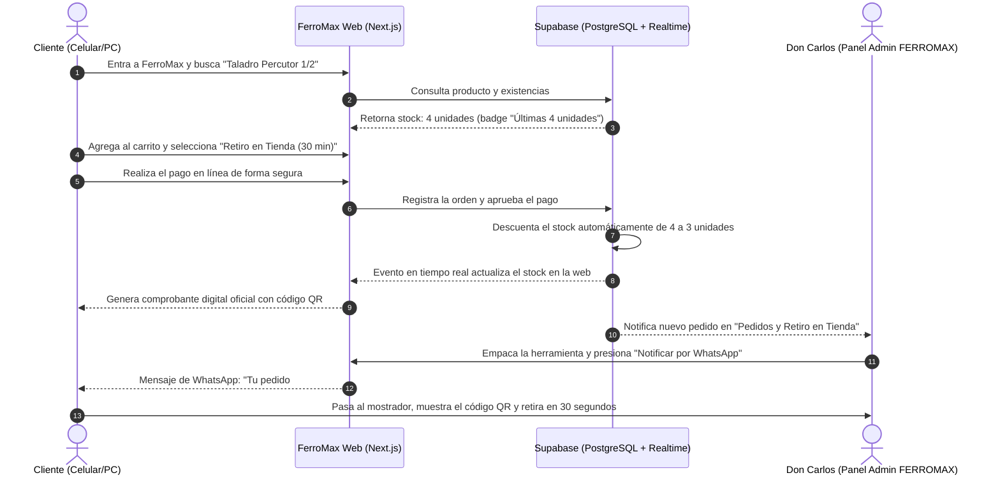

# Contexto del Proyecto: FerroMax (Demo Telar Web)

## 1. Identificación del Proyecto
- **Nombre del Proyecto**: FerroMax – Ferretería y Herramientas ("Tu Ferretería de Barrio")
- **Tipo de Solución**: Sitio Web de Ferretería Tradicional con Catálogo con Inventario en Vivo, Portal de Pagos y Retiro en Tienda, y Suite Administrativa Ligera (POS de Mostrador, Inventario y Despacho).
- **Propósito Estratégico**: Caso de demostración insignia (Showcase Demo) para **Telar Web**, que muestra cómo una ferretería tradicional de barrio o sector comercial puede dar el salto digital con una solución moderna, ágil y a la medida.

> **Aclaración de Identidad**: En los prototipos de diseño iniciales se utilizó temporalmente el nombre "El Maestro" como placeholder en la barra lateral del administrador. **El nombre oficial, definitivo y transversal en toda la plataforma, el catálogo y los paneles de administración es FERROMAX.**

---

## 2. Descripción General
**FerroMax** es la digitalización de una ferretería tradicional orientada a la venta al detal y a la atención de su comunidad local. Combina la calidez, confianza y asesoría técnica del ferretero del barrio (Don Carlos) con la agilidad y precisión de una plataforma web moderna con inventario sincronizado.

La solución unifica:
1. **Página Informativa y Marca**: Presentación de la ferretería, categorías principales, ubicación física en mapa, horarios de atención y canales de contacto directo.
2. **Catálogo con Inventario en Tiempo Real**: Herramientas manuales y eléctricas, plomería, cables, pinturas, fijaciones y tornillería, con etiquetas visuales claras que indican cuántas unidades quedan disponibles en el mesón físico.
3. **Portal de Pagos y Retiro en Mostrador (Click & Collect)**: Canal para que el cliente pague sus compras en línea mediante conexión HTTPS/SSL y recoja su pedido listo en el mostrador en 30 minutos sin hacer filas, o solicite envío a domicilio local.
4. **Historial de Compras y Comprobante Digital**: Sección donde el comprador consulta sus compras anteriores y descarga su recibo con código QR para control de gastos o cobro a sus contratantes.
5. **Canal Asistido de WhatsApp First**: Enlaces contextuales para consultar al asesor de mostrador antes de comprar o resolver dudas sobre qué herramienta o material elegir.
6. **Panel de Administración para Don Carlos (Dueño / Administrador)**:
   - *Panel Principal*: Resumen diario de ventas ($ COP), pedidos web por alistar y alertas de stock bajo.
   - *Inventario y Precios*: Modificación de stock en un solo clic (`+1`, `-1`, `+10`) y edición de precio de mesón en línea.
   - *Ventas del Mostrador y Web (POS)*: Terminal de mesón para cobrar rápido en efectivo, datáfono o PSE y reimprimir comprobantes.
   - *Pedidos y Retiro en Tienda*: Bandeja de alistamiento con disparador automático de WhatsApp para avisar al cliente cuando su pedido está empacado.
   - *Clientes Frecuentes*: Directorio de maestros de obra, técnicos y vecinos habituales.
   - *Configuración de Caja*: Horarios, métodos de pago y datos fiscales.

---

## 3. Problema que Resuelve

### 3.1. Para la Ferretería (Don Carlos)
- **Invisibilidad en internet**: Deja de ser un negocio que no aparece en búsquedas locales y frena la pérdida de ventas frente a grandes almacenes de cadena por no tener presencia digital propia.
- **Consultas repetitivas por teléfono**: Gran parte del día se va respondiendo llamadas o mensajes preguntando *"¿tienen brocas de 1/2?"* o *"¿a cómo está el galón de pintura?"*. Con el catálogo en línea el cliente lo ve directamente.
- **Descoordinación entre mostrador y bodega**: Al tener el inventario sincronizado en tiempo real, Don Carlos evita prometer productos agotados y actualiza existencias con un solo clic en su tablet o celular.
- **Cobro ágil y anticipado**: Facilita el cobro por adelantado para clientes que retiran en tienda o piden a domicilio sin tener que enviar números de cuenta bancaria personales.

### 3.2. Para el Comprador (Clientes de FerroMax)
- **Ahorro de desplazamientos innecesarios**: Evita tener que ir hasta la ferretería solo para preguntar si hay disponibilidad de un material o herramienta.
- **Seguridad antes de salir de casa**: Permite confirmar cuántas unidades quedan en la tienda física desde el celular o el computador.
- **Control de gastos y comprobantes oficiales**: Los trabajadores independientes y clientes particulares guardan el registro de sus compras y descargan los comprobantes digitales con código QR para cobrarle a sus clientes o llevar sus cuentas.
- **Rapidez extrema**: Posibilidad de pagar en línea y simplemente pasar a recoger el paquete al mostrador en 30 minutos sin esperar turno.

---

## 4. Público Objetivo (Clientes de FerroMax)

FerroMax es una ferretería común de barrio enfocada en la venta al detal:

1. **Trabajadores Independientes y Oficios Locales**:
   - *Perfil*: Electricistas, plomeros, cerrajeros, pintores, albañiles y maestros de obra locales.
   - *Necesidades*: Rapidez de atención, verificar existencias de materiales o repuestos antes de desplazarse, precios claros y comprobantes digitales rápidos para cobrarle los materiales a sus propios clientes.
2. **Personas y Familias (Arreglos en el Hogar y Bricolaje)**:
   - *Perfil*: Vecinos y particulares que realizan mejoras, instalaciones o reparaciones domésticas los fines de semana.
   - *Necesidades*: Catálogo visual fácil de entender, saber qué herramienta o tornillo necesitan, verificar disponibilidad en tienda y pagar fácil desde el celular.
3. **Mantenimiento Residencial y del Vecindario**:
   - *Perfil*: Encargados de mantenimiento de casas, edificios o pequeños locales comerciales cercanos.
   - *Necesidades*: Compras cotidianas (bombillos, empaques, siliconas, cerraduras, cables) con respaldo de recibos digitales para rendición de cuentas.

---

## 5. Propuesta de Valor de FerroMax
> *"Tu ferretería de confianza de siempre, ahora en tu celular: revisa si hay existencias en tiempo real, compra o cotiza en un clic y pasa a recoger tu pedido sin filas ni pérdidas de tiempo."*

---

## 6. Funcionalidades Principales

| Módulo | Descripción Funcional |
| :--- | :--- |
| **Landing Page Institucional** | Página de inicio moderna con buscador de barrio, categorías principales, ubicación, horarios y marcas destacadas. |
| **Catálogo con Inventario en Vivo** | Lista de herramientas y materiales con vista Grid y Lista compacta, buscador predictivo, filtros facetados y semáforo de existencias ("En Stock", "Últimas unidades", "Agotado"). |
| **Ficha Técnica y Detalle** | Especificaciones claras, unidades disponibles y botón para comprar o consultar directo por WhatsApp con SKU pre-cargado. |
| **Carrito y Checkout Express** | Selección entre Retiro en Mostrador (Gratuito en 30 min) y Entrega Local, con cálculo transparente de costos. |
| **Portal de Pagos y Recibos QR** | Pago seguro en línea (PSE, tarjeta débito/crédito, contra entrega) y emisión de comprobante de compra descargable e imprimible con código QR. |
| **Historial del Cliente** | Consulta de compras previas mediante correo o número de orden, con acceso a los recibos descargables de cada compra. |
| **Canal Directo de WhatsApp** | Botones de WhatsApp que abren una conversación con el mensaje pre-cargado con el producto o pedido de interés. |
| **Panel de Administración (Don Carlos)** | Suite con Sidebar FERROMAX: KPIs diarios, ajuste rápido de stock (+/- 1 clic), terminal POS de mostrador, bandeja Click & Collect y directorio de clientes frecuentes. |

---

## 7. Flujo de Demostración (User Journey)

---

## 8. Objetivo dentro del Portafolio de Telar Web
Demostrar la escalabilidad de los sitios desarrollados por **Telar Web**: cómo una ferretería tradicional común de barrio puede empezar con una presencia digital rápida y profesional, e integrar un catálogo de productos, base de datos de inventario en tiempo real, portal de pagos y un panel operativo completo adaptado a su negocio.
