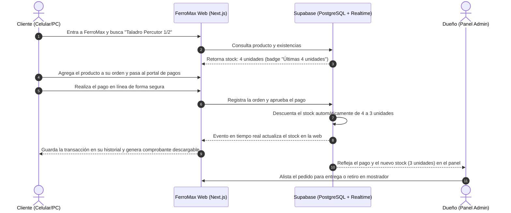

# Contexto del Proyecto: FerroMax (Demo Telar Web)

## 1. Identificación del Proyecto
- **Nombre del Proyecto**: FerroMax – Ferretería y Herramientas
- **Tipo de Solución**: Sitio Web de Ferretería Tradicional con Catálogo de Productos, Inventario en Tiempo Real, Portal de Pagos y Panel Sencillo de Administración.
- **Propósito Estratégico**: Caso de demostración (Demo Showcase) para **Telar Web**, que muestra cómo una ferretería común y corriente de barrio o sector comercial puede dar el salto digital con una solución moderna, rápida y a la medida.

---

## 2. Descripción General
**FerroMax** es el sitio web de una ferretería tradicional que da el paso a internet para mostrar su marca, exhibir su catálogo de herramientas y materiales con inventario en tiempo real, y ofrecer un canal directo de contacto y ventas.

La solución integra:
1. **Página Informativa y Marca**: Presentación de la ferretería, categorías principales, ubicación física en mapa, horarios de atención y canales de contacto directo.
2. **Catálogo con Inventario en Tiempo Real**: Herramientas manuales y eléctricas, tuberías, cables, pinturas, pegantes y cajas de tornillos/fijaciones, con etiquetas visuales claras que indican cuántas unidades quedan disponibles en tienda física.
3. **Portal de Pagos y Comprobantes**: Canal para que el cliente pague sus compras en línea de manera segura mediante conexión HTTPS/SSL y reciba su comprobante de compra descargable.
4. **Historial de Compras del Cliente**: Sección donde el comprador consulta el listado de todas sus compras y pagos anteriores con opción de descargar su recibo para sus cuentas personales.
5. **Canal Directo de WhatsApp**: Botón flotante y enlaces contextuales para consultar al asesor de mostrador antes de comprar o pedir asesoría sobre qué material o herramienta elegir.
6. **Panel Básico para el Dueño**: Vista simplificada e intuitiva para que el ferretero actualice precios, modifique cantidades de stock (sumar/restar unidades) y vea los pagos recibidos sin complicaciones técnicas.

---

## 3. Problema que Resuelve

### 3.1. Para la Ferretería
- **Invisibilidad en internet**: Deja de ser un negocio que no aparece en búsquedas locales y frena la pérdida de ventas frente a grandes almacenes de cadena por no tener presencia digital propia.
- **Consultas repetitivas por teléfono**: Gran parte del día se va respondiendo llamadas o mensajes preguntando *"¿tienen brocas de 1/2?"* o *"¿a cómo está el galón de pintura?"*. Con el catálogo en línea el cliente lo ve directamente.
- **Coordinación de inventario**: Evita vender productos que ya no quedan en estantería y centraliza las existencias disponibles.
- **Canal de cobro ágil**: Facilita el cobro por adelantado para clientes que piden materiales a domicilio o para apartar una herramienta antes de recogerla.

### 3.2. Para el Comprador (Clientes de FerroMax)
- **Ahorro de desplazamientos innecesarios**: Evita tener que ir hasta la ferretería solo para preguntar si hay disponibilidad de un material o herramienta.
- **Seguridad antes de salir de casa**: Permite confirmar cuántas unidades quedan en la tienda física desde el celular o el computador.
- **Control de gastos y recibos**: Los trabajadores independientes y clientes particulares guardan el registro de sus compras y descargan los comprobantes digitales para cobrarle a sus clientes o llevar sus cuentas.
- **Rapidez**: Posibilidad de pagar en línea y simplemente pasar a recoger el pedido listo en el mostrador.

---

## 4. Público Objetivo (Clientes de FerroMax)

FerroMax es una ferretería común orientada a la venta al detal y a la atención de su comunidad local:

1. **Trabajadores Independientes y Oficios Locales**:
   - *Perfil*: Electricistas, plomeros, cerrajeros, pintores, albañiles y maestros de obra locales.
   - *Necesidades*: Atención rápida, revisar existencias antes de ir a la tienda, comprar al detal y tener comprobantes digitales listos para liquidar materiales con las personas que los contratan.
2. **Personas y Familias (Arreglos en el Hogar y Bricolaje)**:
   - *Perfil*: Vecinos y particulares que realizan mejoras, instalaciones o reparaciones domésticas.
   - *Necesidades*: Catálogo claro, fotos entendibles de los productos, saber qué herramientas o tornillos necesitan y poder pagar de forma sencilla desde el celular.
3. **Mantenimiento Residencial y del Vecindario**:
   - *Perfil*: Encargados de mantenimiento de casas, edificios o pequeños locales cercanos.
   - *Necesidades*: Compra rápida de artículos comunes (bombillos, empaques, siliconas, cerraduras, extensiones) con respaldo de recibos digitales.

---

## 5. Propuesta de Valor de FerroMax
> *"Tu ferretería de confianza de siempre, ahora en tu celular: revisa si hay existencias en tiempo real, compra o cotiza en un clic y pasa a recoger tu pedido sin filas ni pérdidas de tiempo."*

---

## 6. Funcionalidades Principales

| Módulo | Descripción Funcional |
| :--- | :--- |
| **Landing Page Institucional** | Página de inicio moderna y adaptada a celular, tablet y computador con buscador, categorías principales, ubicación, horarios y marcas destacadas. |
| **Catálogo con Inventario en Vivo** | Lista de herramientas, pinturas, materiales y fijaciones con buscador, filtros y etiquetas visuales de existencias ("En Stock", "Últimas unidades", "Agotado"). |
| **Ficha Técnica y Detalle** | Foto, marca, especificaciones básicas, unidades disponibles y botón para comprar o consultar directo por WhatsApp. |
| **Carrito y Checkout Sencillo** | Selección de productos, opción de retiro en mostrador o entrega local, y resumen transparente de la compra. |
| **Portal de Pagos y Recibos** | Pago seguro en línea (PSE, tarjeta débito/crédito, contra entrega) y emisión de comprobante de compra descargable e imprimible. |
| **Historial del Cliente** | Consulta de compras previas mediante correo o número de orden, con acceso a los recibos descargables de cada compra. |
| **Canal Directo de WhatsApp** | Botones de WhatsApp que abren una conversación con el mensaje pre-cargado con el producto o pedido de interés. |
| **Panel de Administración (Dueño)** | Vista simplificada para que el dueño actualice precios, sume o reste unidades de stock y revise los pagos recibidos. |

---

## 7. Flujo de Demostración (User Journey)

---

## 8. Objetivo dentro del Portafolio de Telar Web
Demostrar la escalabilidad de los sitios desarrollados por **Telar Web**: cómo una pyme o ferretería tradicional puede empezar con una presencia digital rápida y profesional, e integrar un catálogo de productos, base de datos de inventario y pasarela de pagos a medida que su negocio lo requiera.
