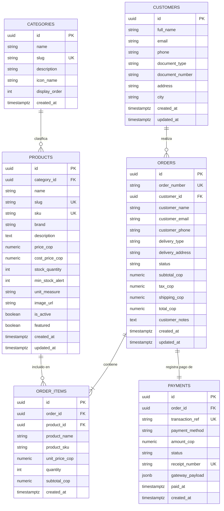

# Diseño de Base de Datos (Supabase / PostgreSQL)

Este documento detalla el esquema relacional, los índices, las funciones transaccionales y las políticas de seguridad (Row Level Security - RLS) diseñadas para la base de datos de **FerroMax** en **Supabase**.

---

## 1. Diagrama Entidad-Relación (ERD)



---

## 2. Definición de Tablas y Esquema SQL

### 2.1. Tabla: `categories`
Almacena los departamentos principales de la ferretería (ej. *Herramientas Eléctricas, Herramientas Manuales, Plomería y Tuberías, Electricidad e Iluminación, Pinturas e Impermeabilizantes, Tornillería y Fijaciones*).

```sql
CREATE TABLE IF NOT EXISTS public.categories (
    id UUID PRIMARY KEY DEFAULT gen_random_uuid(),
    name TEXT NOT NULL,
    slug TEXT NOT NULL UNIQUE,
    description TEXT,
    icon_name TEXT DEFAULT 'wrench',
    display_order INT NOT NULL DEFAULT 0,
    created_at TIMESTAMPTZ NOT NULL DEFAULT now()
);
```

### 2.2. Tabla: `products`
Corazón del inventario. Incluye control de existencias, umbral de alerta de stock bajo y unidad de medida comercial (unidad, galón, metro, kilo, caja).

```sql
CREATE TABLE IF NOT EXISTS public.products (
    id UUID PRIMARY KEY DEFAULT gen_random_uuid(),
    category_id UUID NOT NULL REFERENCES public.categories(id) ON DELETE RESTRICT,
    name TEXT NOT NULL,
    slug TEXT NOT NULL UNIQUE,
    sku TEXT NOT NULL UNIQUE,
    brand TEXT NOT NULL DEFAULT 'Genérico',
    description TEXT,
    price_cop NUMERIC(12, 2) NOT NULL CHECK (price_cop >= 0),
    cost_price_cop NUMERIC(12, 2) CHECK (cost_price_cop >= 0),
    stock_quantity INT NOT NULL DEFAULT 0 CHECK (stock_quantity >= 0),
    min_stock_alert INT NOT NULL DEFAULT 5 CHECK (min_stock_alert >= 0),
    unit_measure TEXT NOT NULL DEFAULT 'unidad' CHECK (unit_measure IN ('unidad', 'galon', 'metro', 'kilo', 'caja', 'rollo', 'litro')),
    image_url TEXT,
    is_active BOOLEAN NOT NULL DEFAULT true,
    featured BOOLEAN NOT NULL DEFAULT false,
    created_at TIMESTAMPTZ NOT NULL DEFAULT now(),
    updated_at TIMESTAMPTZ NOT NULL DEFAULT now()
);
```

### 2.3. Tabla: `customers`
Guarda el registro de los compradores (maestros de obra, profesionales independientes o clientes habituales) para asociar su historial de compras y comprobantes.

```sql
CREATE TABLE IF NOT EXISTS public.customers (
    id UUID PRIMARY KEY DEFAULT gen_random_uuid(),
    full_name TEXT NOT NULL,
    email TEXT NOT NULL,
    phone TEXT NOT NULL,
    document_type TEXT DEFAULT 'CC' CHECK (document_type IN ('CC', 'NIT', 'CE', 'PP')),
    document_number TEXT,
    address TEXT,
    city TEXT DEFAULT 'Bogotá',
    created_at TIMESTAMPTZ NOT NULL DEFAULT now(),
    updated_at TIMESTAMPTZ NOT NULL DEFAULT now()
);
```

### 2.4. Tabla: `orders`
Cabecera de pedidos realizados tanto para retiro en mostrador (*Click & Collect*) como para entrega local a domicilio.

```sql
CREATE TABLE IF NOT EXISTS public.orders (
    id UUID PRIMARY KEY DEFAULT gen_random_uuid(),
    order_number TEXT NOT NULL UNIQUE,
    customer_id UUID REFERENCES public.customers(id) ON DELETE SET NULL,
    customer_name TEXT NOT NULL,
    customer_email TEXT NOT NULL,
    customer_phone TEXT NOT NULL,
    delivery_type TEXT NOT NULL DEFAULT 'pickup' CHECK (delivery_type IN ('pickup', 'delivery')),
    delivery_address TEXT,
    status TEXT NOT NULL DEFAULT 'pending_payment' CHECK (
        status IN ('pending_payment', 'paid', 'preparing', 'ready_for_pickup', 'delivered', 'cancelled')
    ),
    subtotal_cop NUMERIC(12, 2) NOT NULL CHECK (subtotal_cop >= 0),
    tax_cop NUMERIC(12, 2) NOT NULL DEFAULT 0 CHECK (tax_cop >= 0),
    shipping_cop NUMERIC(12, 2) NOT NULL DEFAULT 0 CHECK (shipping_cop >= 0),
    total_cop NUMERIC(12, 2) NOT NULL CHECK (total_cop >= 0),
    customer_notes TEXT,
    created_at TIMESTAMPTZ NOT NULL DEFAULT now(),
    updated_at TIMESTAMPTZ NOT NULL DEFAULT now()
);
```

### 2.5. Tabla: `order_items`
Detalle línea por línea de los productos adquiridos en la orden, preservando el precio histórico del momento de compra.

```sql
CREATE TABLE IF NOT EXISTS public.order_items (
    id UUID PRIMARY KEY DEFAULT gen_random_uuid(),
    order_id UUID NOT NULL REFERENCES public.orders(id) ON DELETE CASCADE,
    product_id UUID NOT NULL REFERENCES public.products(id) ON DELETE RESTRICT,
    product_name TEXT NOT NULL,
    product_sku TEXT NOT NULL,
    unit_price_cop NUMERIC(12, 2) NOT NULL CHECK (unit_price_cop >= 0),
    quantity INT NOT NULL CHECK (quantity > 0),
    subtotal_cop NUMERIC(12, 2) NOT NULL CHECK (subtotal_cop >= 0),
    created_at TIMESTAMPTZ NOT NULL DEFAULT now()
);
```

### 2.6. Tabla: `payments`
Registro de la transacción monetaria, trazabilidad de la pasarela de pagos y número de recibo comercial para consulta del cliente.

```sql
CREATE TABLE IF NOT EXISTS public.payments (
    id UUID PRIMARY KEY DEFAULT gen_random_uuid(),
    order_id UUID NOT NULL REFERENCES public.orders(id) ON DELETE CASCADE,
    transaction_ref TEXT NOT NULL UNIQUE,
    payment_method TEXT NOT NULL CHECK (
        payment_method IN ('pse', 'credit_card', 'debit_card', 'cash_on_delivery', 'bank_transfer')
    ),
    amount_cop NUMERIC(12, 2) NOT NULL CHECK (amount_cop >= 0),
    status TEXT NOT NULL DEFAULT 'pending' CHECK (
        status IN ('pending', 'approved', 'rejected', 'refunded')
    ),
    receipt_number TEXT NOT NULL UNIQUE,
    gateway_payload JSONB DEFAULT '{}'::jsonb,
    paid_at TIMESTAMPTZ,
    created_at TIMESTAMPTZ NOT NULL DEFAULT now()
);
```

---

## 3. Índices de Rendimiento

```sql
-- Índices para catálogo y filtrado rápido
CREATE INDEX IF NOT EXISTS idx_products_category ON public.products(category_id);
CREATE INDEX IF NOT EXISTS idx_products_slug ON public.products(slug);
CREATE INDEX IF NOT EXISTS idx_products_active_stock ON public.products(is_active, stock_quantity);
CREATE INDEX IF NOT EXISTS idx_products_brand ON public.products(brand);

-- Búsqueda de texto completo (Full Text Search) para el buscador de herramientas
CREATE INDEX IF NOT EXISTS idx_products_search ON public.products USING gin(
    to_tsvector('spanish', coalesce(name, '') || ' ' || coalesce(brand, '') || ' ' || coalesce(description, '') || ' ' || coalesce(sku, ''))
);

-- Índices para órdenes y pagos
CREATE INDEX IF NOT EXISTS idx_orders_customer_email ON public.orders(customer_email);
CREATE INDEX IF NOT EXISTS idx_orders_customer_phone ON public.orders(customer_phone);
CREATE INDEX IF NOT EXISTS idx_orders_status ON public.orders(status);
CREATE INDEX IF NOT EXISTS idx_orders_created_at ON public.orders(created_at DESC);
CREATE INDEX IF NOT EXISTS idx_payments_order ON public.payments(order_id);
CREATE INDEX IF NOT EXISTS idx_payments_receipt ON public.payments(receipt_number);
```

---

## 4. Función de Descuento Atómico de Inventario y Control de Concurrencia

Para garantizar que ningún producto sea sobrevendido en compras concurrentes:

```sql
CREATE OR REPLACE FUNCTION public.decrement_inventory_on_payment()
RETURNS TRIGGER AS $$
BEGIN
    -- Solo actuar cuando el pago transiciona a 'approved'
    IF (NEW.status = 'approved' AND (OLD.status IS NULL OR OLD.status != 'approved')) THEN
        -- Actualizar el estado de la orden asociada a 'paid'
        UPDATE public.orders
        SET status = 'paid', updated_at = now()
        WHERE id = NEW.order_id;

        -- Descontar el stock de cada producto vendido verificando existencia
        UPDATE public.products p
        SET stock_quantity = p.stock_quantity - oi.quantity,
            updated_at = now()
        FROM public.order_items oi
        WHERE oi.order_id = NEW.order_id
          AND oi.product_id = p.id;
    END IF;
    RETURN NEW;
END;
$$ LANGUAGE plpgsql SECURITY DEFINER;

-- Disparador asociado
DROP TRIGGER IF EXISTS trg_decrement_inventory ON public.payments;
CREATE TRIGGER trg_decrement_inventory
AFTER INSERT OR UPDATE OF status ON public.payments
FOR EACH ROW
EXECUTE FUNCTION public.decrement_inventory_on_payment();
```

---

## 5. Políticas de Seguridad (Row Level Security - RLS)

Todas las tablas operan con `ALTER TABLE ... ENABLE ROW LEVEL SECURITY;`.

| Tabla | Operación | Rol Permitido | Regla / Condición |
| :--- | :--- | :--- | :--- |
| `categories` | `SELECT` | `anon`, `authenticated` | Lectura pública irrestricta. |
| `categories` | `ALL` | `authenticated` (Admin) | Creación y edición exclusiva del ferretero. |
| `products` | `SELECT` | `anon`, `authenticated` | Lectura pública de productos activos (`is_active = true`). |
| `products` | `ALL` | `authenticated` (Admin) | Modificación de precios y stock desde el panel admin. |
| `customers` | `INSERT` | `anon`, `authenticated` | Registro al momento de realizar la compra. |
| `customers` | `SELECT` | `anon` | Solo el propio cliente verificando su email/teléfono o con service role. |
| `orders` | `INSERT` | `anon`, `authenticated` | Creación de orden durante el flujo de checkout. |
| `orders` | `SELECT` | `anon` | Filtrado restringido por número de orden y email de comprador. |
| `orders` | `ALL` | `authenticated` (Admin) | Gestión completa de pedidos desde el dashboard. |
| `order_items` | `INSERT` / `SELECT` | `anon`, `authenticated` | Acceso condicionado al `order_id` autorizado. |
| `payments` | `INSERT` | `anon` (vía Service Role) | Creación desde Server Action tras validar transacción. |
| `payments` | `SELECT` | `anon` | Consulta de comprobante asociado a orden válida. |
