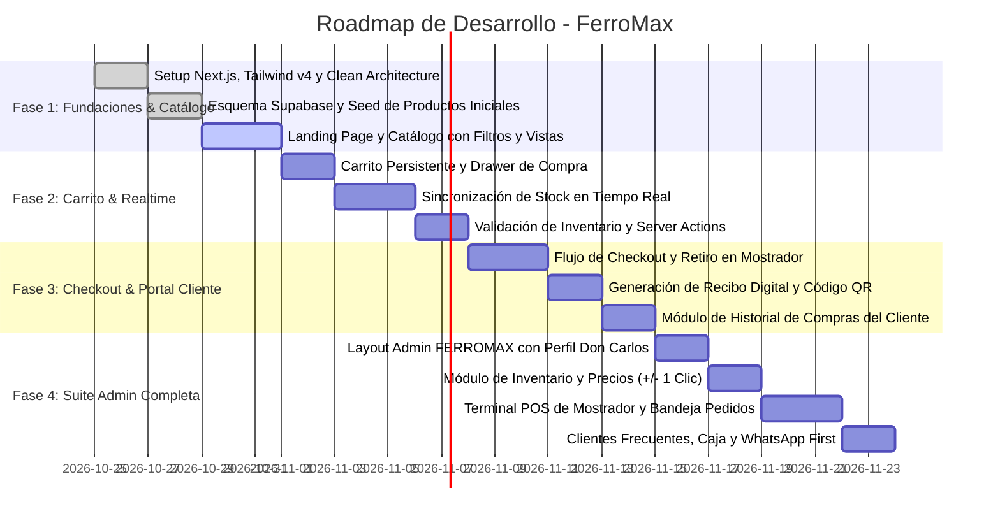

# Planeación de Vistas, Experiencia de Usuario (UX) y Fases de Desarrollo

Este documento define la arquitectura visual, el desglose de pantallas (públicas y administrativas), el flujo de interacción y el plan de desarrollo estructurado en Fases para la plataforma **FerroMax**.

> **Nota de Identidad Visual**: En las maquetas preliminares de diseño el panel administrativo incluía como marcador de posición el nombre "El Maestro". **La marca oficial, consistente y definitiva en toda la plataforma, barra de navegación y panel de administración es FERROMAX ("Tu Ferretería de Barrio").**

---

## 1. Arquitectura de Información y Mapa del Sitio (Sitemap)

```
FerroMax Web
├── Portal Público (Cliente / Comprador)
│   ├── /                                      # Landing Page Comercial e Institucional
│   ├── /catalogo                              # Catálogo Interactivo con Inventario en Vivo (Grid / Lista)
│   │   └── /catalogo/[slug]                   # Ficha Técnica y Detalle del Producto
│   ├── /carrito                               # Resumen del Carrito y Selección de Productos
│   ├── /checkout                              # Proceso de Compra y Retiro en Mostrador / Envío
│   │   └── /checkout/confirmacion             # Comprobante Digital Oficial con Código QR
│   └── /historial                             # Portal de Autogestión del Cliente y Comprobantes
│
└── Panel de Administración (Don Carlos - Dueño / Ferretero)
    ├── /admin                                 # Panel Principal (KPIs diarios, actividad y accesos rápidos)
    ├── /admin/inventario                      # Inventario y Precios (Ajuste rápido +/- 1 clic y edición en línea)
    ├── /admin/ventas                          # Ventas del Mostrador y Web (Terminal POS de Caja)
    ├── /admin/pedidos                         # Pedidos y Retiro en Tienda (Bandeja Click & Collect + WhatsApp)
    ├── /admin/clientes                        # Clientes Frecuentes (Maestros, técnicos y vecinos habituales)
    └── /admin/configuracion                   # Configuración de Caja, Métodos de Pago y Datos de Tienda
```

---

## 2. Sistema de Diseño y Tokens Visuales (Basado en `DESIGN.md`)

- **Canvas Principal**: `#F8FAFC` (Slate ultra claro, libre de reflejos, ideal para lectura de tablas y fichas técnicas).
- **Fondos Estructurales / Sidebar**: `#0F172A` (Deep Slate sobrio e institucional para navegación superior y barra lateral del admin).
- **Acento de Acción Industrial**: `#F97316` (Naranja mecánico reservado para botones principales de compra, cobrar y alertas).
- **Canal Directo WhatsApp**: `#25D366` / `#16A34A` (Verde WhatsApp para soporte inmediato, pedidos asistidos y avisos de retiro).
- **Semáforo de Inventario en Tiempo Real**:
  - *En Stock (> 5 uds)*: Fondo `#DCFCE7` (menta suave) con texto `#15803D` y punto indicador `#16A34A`.
  - *Últimas Unidades (1 a 5 uds)*: Fondo `#FEF3C7` (ámbar claro) con texto `#B45309`.
  - *Agotado (0 uds)*: Fondo `#FEE2E2` (rojo tenue) con texto `#B91C1C`.
- **Tipografía**: **Inter** para títulos, botones y textos generales; **JetBrains Mono** para códigos SKU, tolerancias técnicas, códigos de barra y cifras monetarias con `font-variant-numeric: tabular-nums`.
- **Bordes y Sombras**: Radio de 4px para chips e inputs, 8px para tarjetas y tablas; bordes sutiles en `#E2E8F0` y elevaciones limpias.

---

## 3. Desglose de Pantallas Públicas (Experiencia del Comprador)

### 3.1. Landing Page Comercial (`/` - Basada en `inicio_ferromax`)
- **Top Bar de Confianza**: Horarios de atención física (Lun-Sáb: 7:30 AM a 6:30 PM | Dom: 8:30 AM a 2:00 PM), acceso a "Consultar mi pedido" y línea directa de WhatsApp.
- **Header con Identidad FERROMAX**: Logotipo industrial con ícono de llave, badge animado "EN VIVO" de stock de mesón sincronizado, buscador omnibox y drawer de carrito.
- **Hero Principal Cálido & Dinámico**:
  - Titular: *"Todo para tus proyectos de hogar, reparación y construcción"*.
  - Subtítulo: *"Herramientas, pinturas, plomería y fijaciones con stock garantizado en tiempo real. Retira gratis en tienda en menos de 1 hora o pide a domicilio."*
  - Mini buscador rápido de barrio con sugerencias instantáneas (*"¿Qué necesitas reparar hoy? Ej. llave de paso, brocha, tarugos..."*).
  - Tres sellos de confianza: Stock físico verificado, Retiro en tienda en 30-60 min y Comprobante digital descargable.
- **Departamentos y Materiales**: 6 accesos visuales con conteo de productos (Herramientas Eléctricas, Manuales, Plomería/Gasfitería, Electricidad, Pinturas y Fijaciones).
- **Ofertas de la Semana y Más Buscados**: Grid de tarjetas con semáforo de existencias en tiempo real y precio visible en COP.
- **Sección "¿Cómo funciona comprar en FerroMax?"**: Flujo visual de 4 pasos (Buscar -> Verificar existencias -> Pagar o apartar -> Retirar sin filas).
- **Punto de Venta Físico y Asesoría**: Ubicación en mapa, dirección física, horarios y módulo interactivo para chatear directamente con el ferretero.

---

### 3.2. Catálogo Interactivo con Inventario en Vivo (`/catalogo` - Basada en `catalogo_e_inventario_en_tiempo_real_ferromax`)
- **Barra de Búsqueda Técnica**: Búsqueda por nombre de producto, marca comercial o código SKU de referencia.
- **Filtros Facetados**:
  - Filtro por Categorías principales.
  - Filtro por Marcas aliadas (DeWalt, Bosch, Stanley, Pintuco, Pavco Wavin, Sika, etc.).
  - Filtro de Disponibilidad rápida: Switch *"Solo en stock disponible"*.
- **Selector de Vista**: Alternancia entre **Vista Cuadrícula (Grid)** y **Vista Lista Compacta** (diseñada para compras rápidas por volumen de técnicos y contratistas).
- **Tarjeta de Producto Industrial**:
  - Encabezado con marca y código SKU (`JetBrains Mono`).
  - Badge de existencias en tiempo real con punto de estado.
  - Imagen clara del producto.
  - Nombre técnico y unidad de venta (unidad, galón, metro, caja).
  - Precio formateado en COP con cifras tabulares.
  - Botón primario *"Agregar a orden"* y botón secundario de WhatsApp con mensaje pre-rellenado para resolver dudas técnicas.

---

### 3.3. Carrito y Checkout Exprés (`/carrito` y `/checkout`)
- **Drawer Lateral de Carrito**: Resumen dinámico con cálculo de subtotal y limitador automático que impide añadir más unidades de las existentes en tienda.
- **Checkout en 2 Pasos**:
  - **Paso 1: Datos de Contacto y Modalidad**: Retiro en Mostrador (Gratis, alistamiento en 30 min) o Domicilio Local en la zona.
  - **Paso 2: Pago Seguro**: PSE, Tarjeta, Transferencia o Pago contra entrega en mostrador.
- **Pantalla de Confirmación y Recibo**:
  - Generación de número de pedido `#FM-XXXX` y comprobante de compra con desglose, datos fiscales y código QR para validación rápida en el mostrador.

---

### 3.4. Portal de Historial del Cliente (`/historial`)
- Consulta rápida sin necesidad de contraseñas complejas: ingresando correo electrónico o número de orden.
- Línea de tiempo visual del pedido: `Pendiente de Pago` -> `Pagado` -> `En Preparación en Bodega` -> `Listo para Retiro en Mostrador` -> `Entregado`.
- Descarga o impresión en un clic del comprobante digital comercial.

---

## 4. Desglose de Pantallas del Panel de Administración (Don Carlos)

La suite administrativa comparte un **Sidebar fijo (`bg-[#0F172A]`)** con:
1. **Identidad FERROMAX** (Logo naranja con llave inglesa y subtítulo *"Tu Ferretería de Barrio"*).
2. **Perfil de Don Carlos** (Avatar con iniciales DC, rol Dueño / Administrador).
3. **Indicador de Caja**: *"Caja y Tienda Abierta • Horario Normal"*.
4. **Navegación con 6 módulos especializados**:

### 4.1. Panel Principal (`/admin` - Basada en `panel_de_administraci_n_ferreter_a_el_maestro`)
- **KPIs Diarios**:
  - Total ventas registradas hoy en COP (desglose Mostrador vs Web).
  - Pedidos web pendientes por alistar.
  - Clientes atendidos en el turno.
  - Alertas de stock crítico (< 5 unidades).
- **Accesos Rápidos**: Botón *"Cobrar en Mostrador (POS)"*, *"Ver pedidos web por alistar"*, *"Arqueo de caja"*.
- **Feed de Actividad en Vivo**: Transacciones aprobadas, pedidos listos y alertas de productos que alcanzaron existencia cero.

---

### 4.2. Inventario y Precios (`/admin/inventario` - Basada en `Admin_Inventario_Precios`)
- **Buscador Predictivo de Inventario**: Por SKU, código de barras o nombre de herramienta.
- **Pestañas de Filtrado**: *Todos*, *Stock Bajo (Alerta)*, *Agotados*, *Más Vendidos*.
- **Tabla de Gestión Rápida**:
  - SKU y Nombre de producto.
  - Categoría y Marca.
  - Existencias actuales con semáforo visual.
  - **Ajuste de Stock Rápido en 1 Clic**: Botones `[-1]`, `[+1]`, `[+10]` para modificar unidades físicas inmediatamente en Supabase sin necesidad de abrir modales.
  - **Edición en Línea de Precio**: Campo numérico editable para cambiar el precio de mesón en segundos.
  - Switch de activación/desactivación del producto en la web.

---

### 4.3. Ventas del Mostrador y Web - POS (`/admin/ventas` - Basada en `ventas_del_mostrador_y_web_ferreter_a_el_maestro`)
- **Terminal de Punto de Venta (POS)** para el mesón de atención física:
  - Búsqueda veloz de productos para agregar al carrito de mostrador.
  - Selector de cliente (Cliente Ocasional / Maestro de Obra registrado).
  - Resumen de la cuenta con teclado numérico rápido para ingresar monto recibido en efectivo o procesar datáfono/PSE.
  - Botón *"Reimprimir Última Factura"* y *"Arqueo Rápido de Caja"*.

---

### 4.4. Pedidos y Retiro en Tienda (`/admin/pedidos` - Basada en `pedidos_y_retiro_en_tienda_ferreter_a_el_maestro`)
- **Gestión Click & Collect**:
  - Filtro por estados: *Nuevos por Alistar*, *Listos para Retiro en Mostrador*, *Entregados*, *Cancelados*.
  - Tarjeta de pedido con tiempo transcurrido desde el pago del cliente.
  - Lista de verificación de productos (checklist de bodega).
  - **Disparador WhatsApp Automático**: Botón que abre WhatsApp con el mensaje listo: *"Hola [Nombre], tu pedido #FM-XXXX ya está empacado y listo para que pases a recogerlo en nuestro mostrador"*.
  - Botón para completar entrega validando el código QR o número de comprobante.

---

### 4.5. Clientes Frecuentes (`/admin/clientes` - Basada en `Admin_Clientes_Frecuentes`)
- Directorio de clientes habituales (maestros de obra, electricistas, plomeros del barrio y vecinos).
- Ficha de cliente: Nombre, cédula/NIT, teléfono, compras acumuladas en el mes y notas de preferencia (ej. *"Compre tubos Pavco de 1/2"*).
- Botón directo para contactar por WhatsApp o enviar cotizaciones.

---

### 4.6. Configuración de Caja y Tienda (`/admin/configuracion` - Basada en `Admin_Configuracion_Caja`)
- Datos comerciales de la ferretería (Razón social, NIT, dirección, teléfono, logo para comprobantes).
- Métodos de pago habilitados (Efectivo en mostrador, Datáfono, PSE, Transferencia Nequi/Daviplata).
- Configuración de umbral de alerta de stock mínimo (valor por defecto: 5 unidades).
- Horarios de atención mostrados en la web.

---

## 5. Plan de Desarrollo por Fases (Roadmap)



### Resumen de Entregables por Fase
- **Fase 1 (Fundaciones, Diseño y Catálogo Base)**: Clean Architecture en Next.js 16, diseño industrial según `DESIGN.md`, base de datos Supabase, Landing Page y Catálogo con vista Grid y Lista compacta.
- **Fase 2 (Carrito, Stock y Realtime)**: `CartContext`, sincronización de existencias vía WebSockets con Supabase Realtime y control de límites por stock físico.
- **Fase 3 (Checkout, Pagos e Historial)**: Proceso de compra con opción de Retiro en Mostrador en 30 minutos, comprobante digital imprimible con código QR y consulta de compras en `/historial`.
- **Fase 4 (Suite Administrativa para Don Carlos)**: Dashboard completo con Sidebar **FERROMAX**, ajuste rápido de stock y precios, Terminal POS para ventas de mostrador, bandeja Click & Collect con notificación por WhatsApp y gestión de clientes frecuentes.
