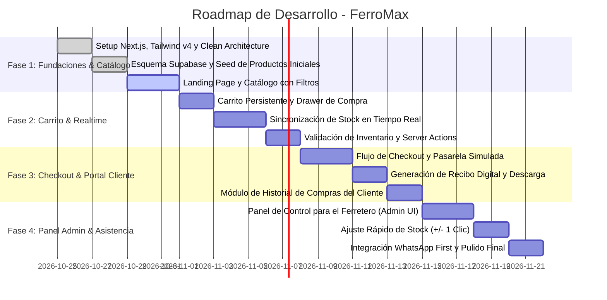

# Planeación de Vistas, Experiencia de Usuario (UX) y Fases de Desarrollo

Este documento define la arquitectura visual, el desglose de pantallas, el flujo del usuario y el plan de desarrollo estructurado en Fases para la plataforma **FerroMax**.

---

## 1. Arquitectura de Información y Mapa del Sitio (Sitemap)

```
FerroMax Web
├── / (Landing Page Comercial e Institucional)
├── /catalogo (Catálogo Interactivo con Inventario en Vivo)
│   └── /catalogo/[slug] (Ficha Técnica y Detalle del Producto)
├── /carrito (Gestión de Productos Seleccionados)
├── /checkout (Proceso de Compra y Selección de Pago)
│   └── /checkout/confirmacion (Recibo Digital de Compra y Éxito)
├── /historial (Portal de Autogestión del Cliente y Comprobantes)
└── /admin (Panel Ligero del Administrador de la Ferretería)
    ├── /admin/inventario (Ajuste rápido de existencias y precios)
    └── /admin/pedidos (Bandeja de preparación y despacho)
```

---

## 2. Detalle de Pantallas y Componentes Clave

### 2.1. Landing Page Comercial (`/`)
El objetivo es transmitir solidez, confianza y modernidad técnica, mostrando que la ferretería cuenta con infraestructura digital de primer nivel.
- **Header / Navigation Bar**:
  - Logo distintivo FerroMax con badge "Inventario en Vivo".
  - Barra de búsqueda omnibox con atajo de teclado (`Cmd+K` o `Ctrl+K`).
  - Enlaces a categorías: *Herramientas*, *Plomería*, *Electricidad*, *Pinturas*, *Tornillería*.
  - Acceso directo a "Consultar Pedido / Historial" y badge interactivo del Carrito de Compras.
- **Hero Section de Alto Impacto**:
  - Titular enfocado en resolver la necesidad del comprador: *"Todo para tus reparaciones y proyectos, con stock real y entrega express"*.
  - Buscador protagónico de productos con etiquetas de sugerencia rápida (ej. *Taladros*, *Cemento blanco*, *Brocas*, *Pintura*, *Cajas de tornillos*).
  - Tres pilares de valor: **Inventario 100% verificado en tienda**, **Retiro en mostrador sin filas** y **Asesoría experta por WhatsApp**.
- **Categorías Populares**:
  - Tarjetas visuales con fotografía de herramientas, ícono de categoría y conteo de productos disponibles.
- **Top Ventas & Destacados**:
  - Grid de productos más buscados con precio en COP y badge de disponibilidad en tiempo real.
- **Banner de Marcas Oficiales**:
  - Marcas reconocidas del sector (DeWalt, Stanley, Bosch, Corona, Pintuco, Pavco Wavin, Sika).
- **Sección de Contacto y Ubicación Física**:
  - Mapa interactivo, dirección física, horarios de lunes a domingo, teléfono directo y botón de WhatsApp flotante.

---

## 2.2. Catálogo Interactivo con Inventario en Tiempo Real (`/catalogo`)
Diseñado para la máxima velocidad de búsqueda, orientado tanto a compras casuales del hogar como a compras al detal de técnicos y maestros de obra.
- **Filtros Laterales / Drawer Móvil**:
  - Filtro por Categoría y Subcategoría.
  - Filtro por Marca.
  - Rango de Precio con control deslizante.
  - Switch *"Solo productos en stock disponible"*.
- **Grid de Productos Dinámico**:
  - Tarjeta de producto con foto optimizada, marca, SKU, precio y **Badge de Disponibilidad**:
    - `Verde (En Stock)`: Más de 5 unidades disponibles.
    - `Ámbar (Últimas unidades)`: 1 a 5 unidades restantes (genera urgencia de compra).
    - `Gris (Agotado)`: 0 unidades (permite consultar reposición por WhatsApp).
  - Botón de adición directa al carrito con animación táctil.
  - Botón secundario *"Preguntar al ferretero"* que abre WhatsApp con el producto preseleccionado.

---

## 2.3. Ficha Técnica de Producto (`/catalogo/[slug]`)
- Galería con imágenes claras para apreciar el detalle de la herramienta o acabado del material.
- Ficha técnica en tabla limpia: Marca, SKU, Voltaje, Dimensiones, Peso, Garantía y Unidad de venta (por unidad, galón, caja, metro).
- Selector de cantidad con limitador que impide seleccionar más unidades de las disponibles físicamente.
- Módulo de productos complementarios frecuentemente comprados juntos (ej. Pulidora angular + Discos de corte + Gafas de protección).

---

## 2.4. Carrito y Checkout Exprés (`/carrito` y `/checkout`)
- **Drawer de Carrito**: Acceso instantáneo sin abandonar la página actual.
- **Pantalla de Checkout Simplificada en 2 Pasos**:
  - **Paso 1: Datos del Comprador y Modalidad de Entrega**:
    - Nombre completo, número de documento (para facturación), WhatsApp y correo electrónico.
    - Elección entre **Retiro en Tienda (Gratuito)** o **Envío a Domicilio Local**.
  - **Paso 2: Pago Seguro**:
    - Simulación interactiva de Pasarela de Pagos (PSE / Transferencia Bancaria / Tarjeta de Crédito / Pago contra entrega).
    - Visualización clara del subtotal, costo de envío y total en Pesos Colombianos (COP).
  - Al procesar el pago, se valida el stock de forma atómica en Supabase y se genera la orden en estado `paid`.

---

## 2.5. Portal de Pagos e Historial del Cliente (`/historial`)
- Acceso sin registro obligatorio complejo: el cliente simplemente ingresa su número de orden o su correo electrónico/número de documento.
- Visualización de la lista de compras realizadas con fecha, valor total y estado actual:
  - `Pendiente de Pago`
  - `Pagado / Confirmado`
  - `En Preparación en Bodega`
  - `Listo para Retiro en Mostrador`
  - `Entregado`
- **Comprobante Digital Descargable**:
  - Visualización del recibo con diseño limpio: logo de FerroMax, número de recibo, datos de la ferretería, desglose detallado de ítems y código QR.
  - Botón directo para imprimir o descargar en PDF.

---

## 2.6. Panel de Administración del Ferretero (`/admin`)
Herramienta de control pensada para el dueño o encargado de la ferretería, diseñada para usarse cómodamente desde una tablet en el mostrador o el celular:
- **Resumen Ejecutivo (KPIs)**:
  - Total ventas registradas en el día (COP).
  - Cantidad de pedidos pendientes por preparar o entregar.
  - Contador de productos con alerta de stock crítico (< 5 unidades).
- **Gestión Rápida de Inventario (`/admin/inventario`)**:
  - Buscador rápido por código de barras / SKU o nombre.
  - Botones de acción instantánea en cada fila: `[-1]`, `[+1]`, `[+10]` para modificar existencias sin abrir formularios.
  - Campo de edición directa de precio de venta.
  - Alerta visual resaltada en rojo para productos con existencias en cero.
- **Bandeja de Pedidos (`/admin/pedidos`)**:
  - Listado de pedidos cronológicos con un clic para cambiar de estado (ej. de *"Pagado"* a *"En Preparación"* o *"Listo para Retiro"*).
  - Botón para contactar al comprador directamente por WhatsApp con un mensaje predefinido: *"Hola, tu pedido #FM-1024 ya está listo para que pases a recogerlo en nuestro mostrador"*.

---

## 3. Plan de Desarrollo por Fases (Roadmap)



### Resumen de Fases
- **Fase 1 (Fundaciones, Diseño y Catálogo Base)**: Configuración de Clean Architecture, creación de tablas en Supabase, carga de productos ferreteros con fotos y descripciones técnicas, Landing Page y navegación responsive.
- **Fase 2 (Carrito, Stock y Realtime)**: Integración de `CartContext`, persistencia local, suscripción WebSocket a Supabase Realtime para actualización instantánea de stock en pantalla y Server Actions para validar inventario.
- **Fase 3 (Checkout, Pasarela e Historial)**: Pantalla de checkout con cálculo de entrega, simulación de pago PSE/tarjeta con confirmación, emisión del comprobante digital y vista `/historial` para clientes.
- **Fase 4 (Dashboard de Administración & WhatsApp First)**: Interfaz `/admin` protegida para el ferretero con actualización rápida de stock, bandeja de pedidos en tiempo real, alertas de stock mínimo y mensajes pre-estructurados de WhatsApp.
